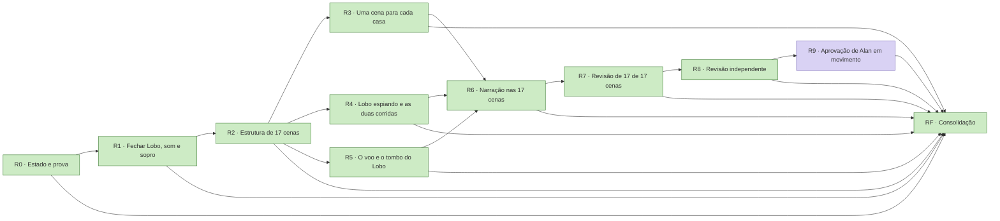

# Gauntlet — 17-cenas

Preparado em 2026-11-06. **Executado: R0 a R8 e RF concluídas; R9 aguarda Alan** (estado em 09/11/2026, tabela abaixo). Gerar ou ler este arquivo não executa nada. A execução começa quando Alan cola o
texto abaixo numa sessão, ou diz "vamos avançar". O estado vive no livro `prototypes/tres-porquinhos-carrossel/docs/gauntlet-17-cenas.json`; este documento é a receita.

## Texto para colar

```text
/goal Livro Os Três Porquinhos com 17 cenas coerentes, com narração, e 17 de 17 revisadas em captura e em movimento, com o Lobo voando e caindo do lado da casa e uma cena para cada casa construída (prototypes/tres-porquinhos-carrossel), pelo livro prototypes/tres-porquinhos-carrossel/docs/gauntlet-17-cenas.json e pela receita prototypes/tres-porquinhos-carrossel/docs/gauntlet-17-cenas.md. Comece com `python3 squads/goal-gauntlet/scripts/gauntlet.py placar prototypes/tres-porquinhos-carrossel/docs/gauntlet-17-cenas.json` e `python3 framework/scripts/game.py context prototypes/tres-porquinhos-carrossel --event resume`; se o placar disser TETO ATINGIDO, consolide e entregue o estado; se outra sessão escreve no alvo ou o placar mostra outro escritor, combine a passagem antes de escrever (`assumir --escritor <esta sessão>`: um escritor por vez). Trabalhe com a skill game-dev. Uma rodada por vez, na ordem das dependências: `marcar <id> em-andamento`, faça, e só conclua com `python3 squads/goal-gauntlet/scripts/gauntlet.py fechar prototypes/tres-porquinhos-carrossel/docs/gauntlet-17-cenas.json <id> --prova "<o que e onde>"`, que roda os gates. Nunca edite critério, rodada ou gate do livro. Rodada de entrega pede --url, --captura e, em coleção, --cobertura com --saida; número da prova vem de arquivo de saída, nunca digitado. Depois de cada rodada verde, faça o commit local que o fechar sugere (sem push). Releia a prioridade de Alan que o placar mostra antes de escolher a rodada. Duas tentativas sem evidência nova (o placar diz SEM PROGRESSO): `marcar <id> bloqueada --motivo … --desbloqueia …` e siga para a próxima elegível; escolha que só Alan faz vira `aguarda-alan --decisao …`. Não invente número, tarefa nem prova. Limites: Commit local por rodada fechada, sem push nem publicação sem pedido; caminhos portáveis; preservar trabalho de outras sessões; testes headless. Pronto quando `python3 squads/goal-gauntlet/scripts/gauntlet.py placar prototypes/tres-porquinhos-carrossel/docs/gauntlet-17-cenas.json` imprimir GAUNTLET FECHADO nesta conversa, com a rodada final fechada pelo `fechar`, que roda os gates globais (`npm run test` em prototypes/tres-porquinhos-carrossel) e mostra cada um saindo 0; então resuma concluídas, bloqueadas com o que as destrava e as decisões pendentes de Alan.
```

## Objetivo e pronto quando

- **Objetivo:** Livro Os Três Porquinhos com 17 cenas coerentes, com narração, e 17 de 17 revisadas em captura e em movimento, com o Lobo voando e caindo do lado da casa e uma cena para cada casa construída.
- **Alvo:** `prototypes/tres-porquinhos-carrossel` (jogo, módulo tres-porquinhos-carrossel).
- **Pronto quando:** `python3 squads/goal-gauntlet/scripts/gauntlet.py placar "prototypes/tres-porquinhos-carrossel/docs/gauntlet-17-cenas.json"` imprime `GAUNTLET FECHADO`
  na conversa, e os gates globais saem 0. Uma rodada bloqueada ou à espera de Alan conta como fechada para o agente,
  desde que o motivo esteja escrito no livro.

## Onde estamos

Fatos medidos de onde o gauntlet parte, e o que já está fechado e não se refaz. Cada item leva caminho ou recibo.

- Na partida (06/11/2026), antes das rodadas: o livro tinha 11 cenas no ar (`src/story.js`). Último commit do módulo: 2a1f22f; o Lobo recortado, a sonoplastia e o modo grito estão sem commit, com 58 de 60 testes verdes (`output/som-npm-test.log`).
- As duas falhas são conhecidas: limite do ambiente sob a voz, já ajustado e verde em nova execução (de 0,56 para 0,8, porque o ambiente sob a voz subiu de propósito), e o balão do grito contando como balão de fala em `tests/sincronia.test.mjs`, a corrigir no código na R1.
- Mixagem medida com `tests/mix-medida.mjs`: cenas 2, 4 e 7 em -13,6, -13,4 e -13,6 LUFS; o limitador sobe 1,14 dB um sinal abaixo do limiar (-20 para -18,86 dBFS).
- Modo sopro: `tests/sopro.test.mjs` 10 de 10. Biblioteca `shared/sfx` já publicada (b23b33176) com o uivo novo.
- Cunha fixa em 45° (`src/book.js:8`): página nova não aperta a arte.
- Texto e encenação das cenas novas: `output/agentes/porquinhos-17-cenas-plano.md`; checagens em `tests/coerencia-17.test.mjs`, que falham até as cenas existirem.

## Rodadas

<!-- gauntlet:rodadas -->
| Rodada | Entrega | Fecha quando | Depende | Estado |
|---|---|---|---|---|
| **R0** | Estado e prova | Gates globais rodados com recibo; 'Onde estamos' confere com o disco. | — | concluida |
| **R1** | Fechar Lobo, som e sopro | tests/sopro, sincronia e narracao verdes; 3 commits no main (Lobo, som, sopro); nota nova em docs/pesquisas com fontes e medições. | R0 | concluida |
| **R2** | Estrutura de 17 cenas | As 17 cenas montam, sem erro no console, e o teste de estrutura passa; as 10 cenas antigas passam os mesmos testes de antes nos novos índices. | R1 | concluida |
| **R3** | Uma cena para cada casa | 3 de 3 casas nascem do zero e terminam no mesmo lugar e no mesmo tamanho da cena do sopro; captura das 3 lida. | R2 | concluida |
| **R4** | Lobo espiando e as duas corridas | Testes de espia e corridas verdes; captura das 3 cenas lida. | R2 | concluida |
| **R5** | O voo e o tombo do Lobo | Testes de voo e tombo verdes: fim do tombo igual ao início da fuga em posição e tamanho, do Lobo e dos 3 porquinhos; captura do voo inteiro lida. | R2 | concluida |
| **R6** | Narração nas 17 cenas | 17 de 17 faixas no manifesto, balões e gestos ancorados; narracao e sincronia verdes. | R3, R4, R5 | concluida |
| **R7** | Revisão de 17 de 17 cenas | 17/17 folhas capturadas pelo script e lidas, com defeitos numerados e corrigidos; suíte completa verde. | R6 | concluida |
| **R8** | Revisão independente | Relatório em output/agentes/porquinhos-auditoria-17.md; cada apontamento corrigido ou recusado com o motivo; percurso real 3 vezes sem erro. | R7 | concluida |
| **R9** | Aprovação de Alan em movimento | Mensagem de Alan aprovando as 17 cenas em movimento. | R8 | aguarda-alan: Aprovar em movimento as 17 cenas, o Lobo e a sonoplastia, abrindo o livro em http://127.0.0.1:4291/ (capa, abrir, cada cena e fim) |
| **RF** | Consolidação | Gates globais verdes; canônico atualizado com resultado, lacunas e próxima ação; commit local feito; nada enviado (push) nem publicado sem pedido. | R0, R1, R2, R3, R4, R5, R6, R7, R8, R9 | concluida |
<!-- /gauntlet:rodadas -->

<!-- gauntlet:dag -->

<!-- /gauntlet:dag -->

## Regras

- **Uma rodada por vez**, na ordem das dependências. `placar` mostra as elegíveis. Comece uma rodada com
  `gauntlet.py marcar "prototypes/tres-porquinhos-carrossel/docs/gauntlet-17-cenas.json" <id> em-andamento`.
- **Só `fechar` conclui.** O `gauntlet.py fechar "prototypes/tres-porquinhos-carrossel/docs/gauntlet-17-cenas.json" <id> --prova "<o que foi entregue e onde>"` roda os gates
  da rodada e os globais pelo `game.py verify` e grava o recibo. Gate vermelho mantém a rodada aberta.
- **Entrega não é só gate verde.** Rodada de entrega (`entrega`/`colecao` no livro) fecha com `--url` conferida,
  `--captura` lado a lado com a referência e, em coleção, `--cobertura N/M` com `--saida` (N de N tirado do arquivo de
  saída do comando, nunca digitado). Número na `--prova` vem de `--saida`. Defeito devolvido por Alan vira checagem
  nomeada antes do próximo "pronto". Celular emulado é "não testado em aparelho".
- **Commit local por rodada fechada**, em `main`, sem push: o `fechar` imprime o comando. Teste afrouxado
  depois de falha aparece como `testes_alterados_apos_falha` e não conta como prova. Handoff em `output/agentes/` ou
  `~/.claude/handoffs/`, nunca em `/tmp`.
- **O livro está selado.** Critério, rodadas, dependências e gates não mudam durante a execução. Mudar exige pedido de
  Alan e `gauntlet.py selar --motivo`. Apagar ou afrouxar um gate para passar é falha, não progresso.
- **Número sem origem fica desconhecido.** O código mede, não calibra. Um PASS estrutural não prova conteúdo: a
  `--prova` diz qual artefato sustenta o critério.
- **Sem avanço, muda a hipótese.** Duas tentativas sem evidência nova bloqueiam a rodada:
  `marcar <id> bloqueada --motivo … --desbloqueia …`. Depois, siga para a próxima elegível. Uma escolha que só Alan
  faz vira `aguarda-alan --decisao …`.
- **Revisão própria se declara como própria.** Um crítico independente só entra com autorização e isolamento.

## Fora

- Commit local no main, sem worktree nem branch, a cada rodada fechada (o fechar imprime o comando, só com os arquivos desta sessão); push e publicação só com pedido de Alan (publicar é pelo gameops). Handoff em output/agentes/ ou ~/.claude/handoffs/, nunca em /tmp.
- Caminhos portáveis (relativos, <repo-root>, ~); nenhum caminho absoluto de máquina, .env, chave ou credencial em arquivo versionado.
- Preservar alterações de outras sessões: um escritor por área; não matar processo que esta sessão não iniciou.
- Testes headless com a GPU real (--use-angle=metal --ignore-gpu-blocklist), sem Claude in Chrome e sem roubar foco.
- O piso visual e sonoro aprovado não se troca por desempenho, custo ou prazo.
- Vídeos, renders e capturas vão para o acervo do Drive, não para o Git.
- Subagente só no modelo mais barato capaz, com brief fechado e conferência na fonte; julgamento visual e revisão crítica ficam na sessão principal.
- Decisão de design aprovada só muda com Alan; uma variável por vez quando a causa importa.
- Continuidade no canônico do framework (Devlog/plano); game.py context antes de cada fatia.

## Decisões que só Alan toma

1. Aprovar as 17 cenas em movimento: só Alan aprova visual (R9).
2. Publicar: o deploy não foi pedido nesta rodada.
3. Ouvir a mixagem, os convites e as narrações novas, e testar o grito com criança, microfone real e telefone.

## Retomada

1. Rode `python3 squads/goal-gauntlet/scripts/gauntlet.py placar "prototypes/tres-porquinhos-carrossel/docs/gauntlet-17-cenas.json"` e depois o contexto: `python3 framework/scripts/game.py context prototypes/tres-porquinhos-carrossel --event resume`.
2. Uma rodada `em-andamento` recomeça pelo gate. Um recibo antigo não vale como atual.
3. O `/goal` volta sozinho com `claude --continue` ou `--resume`, com a contagem de turnos zerada. No Codex, use
   `/goal resume`. O livro é a fonte do estado, não a memória da conversa.

## Fontes

- Livro: `prototypes/tres-porquinhos-carrossel/docs/gauntlet-17-cenas.json`. Skill: `squads/goal-gauntlet/SKILL.md`.
- `prototypes/tres-porquinhos-carrossel/AGENTS.md`
- `framework/references/gauntlet.md`
- `framework/references/process.md`
